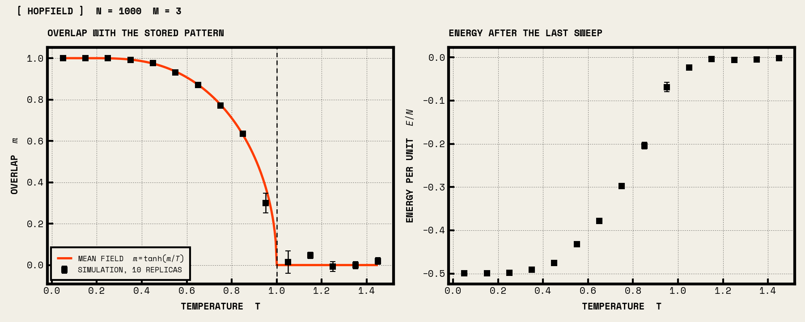
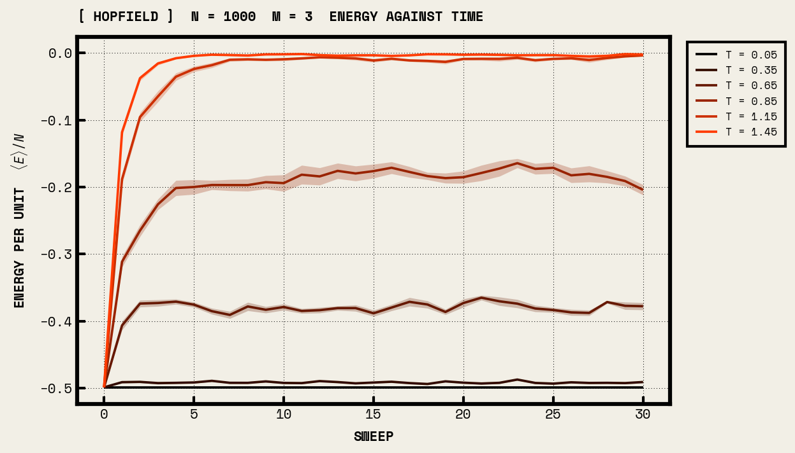
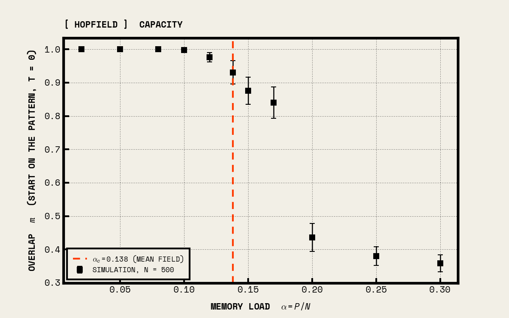

# Hopfield Model

Hopfield network with asynchronous Glauber dynamics, for the temperature and the memory load of the mean field analysis in [docs/hopfield_mean_field.pdf](docs/hopfield_mean_field.pdf) (Orhan, after Hertz, Krogh & Palmer) and in [Neuronal Dynamics, chapter 17.2](https://neuronaldynamics.epfl.ch/online/Ch17.S2.html).

## The model

```
W_ij = (1/N) sum_mu xi^mu_i xi^mu_j,  W_ii = 0            Hebb
h_i  = sum_j W_ij S_j
P(S_i = +1) = 1/2 [1 + tanh(h_i / T)]                     T = 0: S_i = sign(h_i), sign(0) = +1
E    = -1/2 sum_ij W_ij S_i S_j                           printed and plotted per unit, E/N
m^mu = (1/N) sum_i xi^mu_i S_i                            overlap with the pattern mu
```

A sweep updates the `N` units one at a time, in a new random order, each with the current state of the others. Expected: the stored patterns are fixed points for small `M/N`; at `M/N -> 0` the overlap is the solution of `m = tanh(m/T)`, so retrieval exists for `T < 1`; at `T = 0` it disappears at `alpha = M/N` of about 0.138.

## Use

```
pip install -e ../plot_style                 # style of the figures (once)
python hopfield.py --N=1000 --M=3 --replicas=10 --iter=30 --Tmin=0.05 --Tmax=1.5 --Tby=0.1 --plot --threads=4
python hopfield.py --capacity --N=500 --replicas=20 --iter=20 --plot --threads=4
python hopfield.py --finite-size --Ns=100,200,400,800,1600,3200 --replicas=40 --iter=100 --plot --threads=4   # 3 min
python hopfield.py --finite-size --from-json=figs/finite_size.json --plot                                      # refit, no simulation
python -m pytest test_hopfield.py
```

Run it from a file or the shell, not from `python -` or a notebook cell: `Pool` needs to import the main module.

`--start=pattern` (default) starts from pattern 0 with a fraction `--noise` of the bits flipped, and `m` is the overlap with it; `--start=random` starts from a random state and `m` is the largest `|m^mu|` reached. Everything is reproducible with `--seed`. The figures go to `figs/`.

## Results

Overlap and energy against `T` (`N = 1000`, `M = 3`, 10 replicas, 30 sweeps, start on pattern 0), against the mean field curve `m = tanh(m/T)`:



The simulation follows the mean field curve; the transition is rounded around `T = 1` by the finite `N` and by the crosstalk of the other patterns. Energy per unit against the sweeps:



Capacity at `T = 0` (`N = 500`, starting on the pattern):



The overlap is above 0.97 up to `alpha = 0.12` and falls to 0.43 at `alpha = 0.2`. The mean field value 0.138 is for `N -> infinity`, here the drop is spread over `alpha` between 0.14 and 0.2: at `alpha = 0.17` the replicas end with overlaps between 0.34 and 1.0, at 0.2 most are between 0.3 and 0.5.

